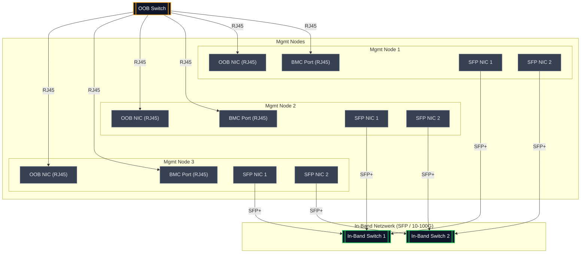
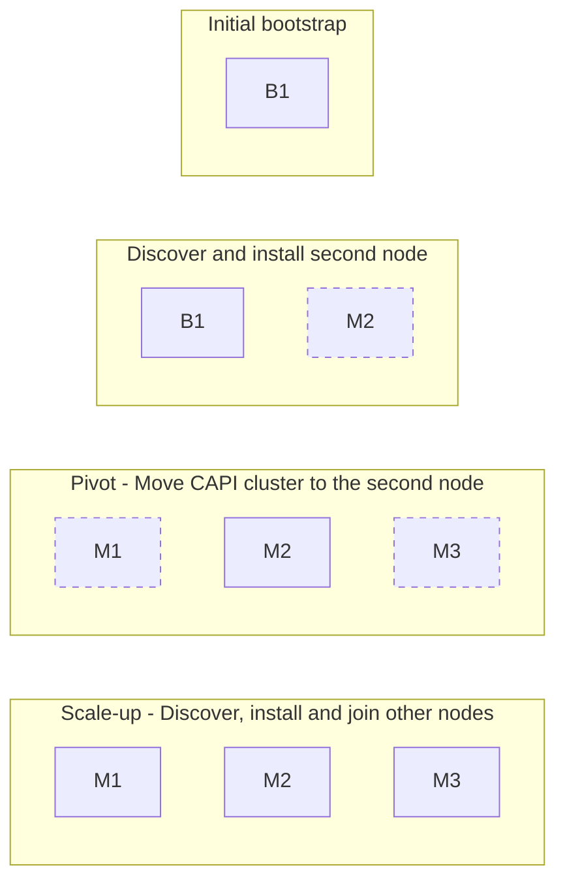

# Lights-Out to Running Cluster

This guide describes an IronCore deployment on a cabled but lights-out datacenter (DC). If your DC
has multiple zones which you want to manage individually, the bare metal stack is deployed _per
zone_ and the IaaS (or other management on top) might span the zones. Following the steps you will

* install a management (mgmt) CAPI cluster on dedicated nodes which will backs the bare metal
  automation
* use the bare metal automation to discover all servers and make them usable
* put the IronCore IaaS layer on top for easy managment of your server resources.

The installation consists of multiple steps, building on top of each other. It is possible to omit
steps by brining the system in the same result state described in the previous step.

> [!Important]
> The guide assumes familiarity with the IronCore project and core concepts.

[[toc]]

## 0. Prerequisites

### Hardware State

* Fully cabled zone/datacenter (DC) (TODO link the canary landscape disclosure)
* All nodes' BMC must be connected to the OOB (out-of-band network)
* All nodes must be connected to the in-band network
* All nodes BMC are powered, servers are powered-off initially
* Nodes hosting the CAPI cluster (from now on called "mgmt nodes") _additionally_ require a
  connection to the OOB
	* The OOB is used by FeDHCP for node discovery via leased addresses to BMCs on the OOB (TODO
	  Link bare metal guide)

The following figure shows the mgmt node setup, explicitly showing a second OOB interface beyond the
always existing for the BMC. Note that in our case mgmt nodes are multi-homed on the in-band for
fail-safety.

### Network State

Here, endpoint denotes (IP + port) tuples; not to be confused with `Endpoint` resources in the CAPI
cluster.

* OOB connectivity/reachability (everyone-to-everyone)
    * Each endpoint has to be able to reach every other _on the OOB_
    * **Important:** The bootstrap step below relies on DHCP leases to the BMCs on the OOB for
	  server discovery. SLAAC or setups with another DHCP server are currently not supported.
    * _Recommendation:_ Don't let in-band talk into the OOB for security reasons.
* In-Band connectivity/reachability (everyone-to-everyone)
    * No strict requirements on routing protocols
    * You need to be able to download images from in-band
        * If images are not available in the DC, upstream to the Internet is required.
        * **Important:** The current IronCore bare metal server discovery uses an ignition image
          fetched from the Internet. That makes Internet access mandatory, currently.
* For DHCP to work, switches must be in relay mode! Otherwise, no leases from FeDHCP are possible.

**Example Setup disclosure**
* Leaf-spine architecture
* OOB routable addresses obtained via DHCP
    * BMCs only obtain routable IPs once FeDHCP is deployed during CAPI cluster bootstrapping. Prior
	  to that, you should still be able to ssh to the BMCs via link local addresses from the OOB
	  switches.
    * To support troubleshooting, the OOB network setup allows switching to SLAAC to reach the BMCs,
	  in case we cannot connect to them via link-local IPs. This is only a last resort and we use it
      for troubleshooting and to reboot the BMC. No server discovery possible with SLAAC!
* In-band uses BGP
* Both OOB and in-band are IPv6-only
* Zone edge is dual-stack
    * Require IPv4 connectivity for mirrors (GitHub)
    * DNS64, NAT64 
* Rules to on the router to prevent in-band to OOB reachability (security)
    * Optimally, live without OOB connectivity to the Internet

## 1. Bootstrapping CAPI Cluster

This step installs the CAPI cluster on the mgmt nodes. The CAPI cluster manages the servers
(discovery, claiming, ...) eventually and runs the relevant operators (`metal-operator`,
`boot-operator`) and also FeDHCP.

Since the mgmt nodes itself should be discovered and claimed via the same mechanism, it is a
chicken-egg problem. To solve this, a bootstrap mechanism first creates a temporary CAPI cluster on
a manually installed node, starts a second node via the bare metal discovery mechanism, sets up the
real CAPI cluster on that second node and finaly scales-up by joining both the orinal bootstrap node
and a third node to host the final cluster.

The installation steps are roughly shown in the following figure. The steps are Ansible roles which
can be run once a first bootstrap node is installed (see below). The figure distinguishes between
the following node types:

- B1 = initial bootstrap node forming a temporary cluster (single-node); it must be one of the mgmt
  nodes because it requires the OOB interface for FeDHCP.
- M1 ... M3 = final mgmt nodes forming the real CAPI cluster.

The initial bootstrap node B1 will be reused as mgmt node M1 during the process.

### Additional Prerequisite

The control plane (CP) as deployed in this step, uses DHCP, i.e., FeDHCP, for discovering servers.
This makes the deployment incompatible in datacenters running a different/other DHCP server or BMCs
obtaining IP addresses via SLAAC. The bare metal automation can also be set up in other ways, refer
to the [official documentation](TODO Proper link)

### Setting up the Bootstrap Node

Currently setting up the bootstrap node is a manual step. For this, one of the mgmt nodes needs an
OS and network connectivity via both its OOB and in-band interfaces. Note that for the CAPI cluster,
you also need to set up a service prefix which is routed to the mgmt node as well. Additionally, the
node must be configurable via Ansible.

In our setup, this is a manual step. We boot our favorite Debian-based OS. Via FRR, we obtain a
routable `lo` IP address and announce a service prefix for the CAPI cluster on the in-band.

**Expected State:**

* OOB link up
    * You should be able to ping BMCs
* in-band link up
    * You should be able to ping in-band nodes (if powered on) or routers
    * If uplink is available, you should be able to ping, e.g., google.com
* Could be two each, if dual-homed
* K8s service prefix is announced/routable
    
### Run delivery Ansible
    
> [!Important]
> The Ansible roles are still to be disclosed. For now, you can do the installation manually via the
> [extensible guide](TODO link the Damyan guide).

You can run the full Ansible playbook in a single step. The mgmt node discovering via the bare metal
automation (performed for each mgmt host once during the setup) might take hours currently. FeDHCP
discovers via DHCP lease to the BMCs but they might have received leases. In that case, discovery
will stall until the lease is renewed. You can poke your BMC (restart networking or rebooting) to
get a new lease immediately and unblock discovery. There are plans to automate this in the future.

> [!Note]
> In case there is no progress for any of the roles, refer to the respective extensive documenation.
Note that some roles might take a while, e.g., when installing OSes.

**Disclaimer:** Make yourself familiar with Ansible and especially the `-l` parameter!

If you decide not to run the Ansible playbook in a single step, e.g. for the purposes of
step-by-step debugging, you may use the following tags to execute the steps individually:

* `--tag kubernetes`
    * Create a temporary K8s cluster with `kubeadm` ([details](todo link target))
* `--tag bootstrap`
    * Deploys the metal stack & [discovers](TODO link to node discovery?) the second mgmt node
      ([details](todo link target))
* `--tag capi-cluster`
    * Boot second mgmt node & create new CAPI cluster there ([details](todo link target))
* `--tag capi-bootstrap`
    * Deploy required components to the new CAPI cluster ([details](todo link target))
* `--tag pivot`
    * Move resources from the temporary CAPI cluster on the bootstrap node to the final CAPI cluster
	  on the second node ([details](todo link target))
* `--tag scale-up`
    * Scale the CAPI cluster to all mgmt servers includes the original bootstrap node
	  ([details](todo link target))
    * Expect this to take up to 30 minutes per node joining the cluster
    
    
### Verify CAPI Cluster

* CAPI cluster reachable
* All pods in `Running` state
* In the cluster, all mgmt nodes are in `Ready` state
* The `Cluster` CR has `Available=True` and `CP Available = 3`

## 2. Bare Metal Server Discovery

Now that the mgmt cluster is up, the compute/storage nodes can be discovered using the bare metal
automation. In-depth documentation can be found [here](TODO link target).

> [!Important]
> If you didn't follow the CAPI cluster bootstrapping above, it is your responsibility to deploy the
> bare metal stack. Otherwise, all relevant components already run in the CAPI cluster.

The servers are discovered by FeDHCP when leasing out IPs via DHCP for _configured_ MAC addresses.
Extend FeDHCP's MAC configmap with all BMC MACs to discover. Note that you have to restart FeDHCP
for the configmap to become active.

As stated above, you might need to poke BMCs to re-lease IPs for the discovery to take place.

For the `metal-operator` to finish server discovery, ensure the BMC credential database is
available. You also might need to restart the `metal-operator` afterwards.

### Verify Server Discovery

All `Endpoint`, `BMC` and `Server` objects exist and `Server` objects are in state `Available`.

## 3. Install IaaS

Once the servers were discovered, they can be put to use. For this, the IaaS layer can be put on top
to allow claiming VMs, allocating storage volumes, etc. For this conduct the
[IronCore IaaS](TODO Link) documentation.

Alternatively, the servers can be claimed for any other workload.
